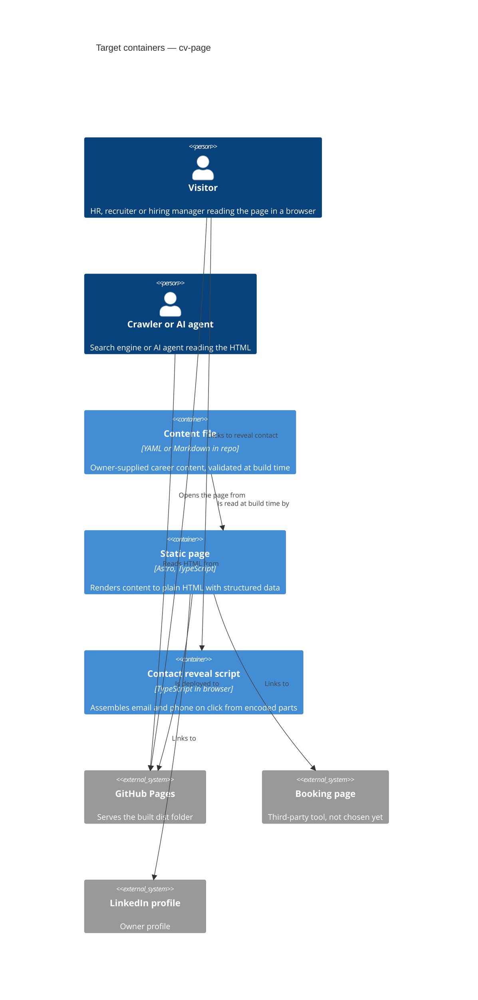

# Architecture map — cv-page

> **Greenfield foundation (target baseline).** Nothing is built yet; this map records the decided
> foundation that `scaffold` will materialize. Commands in the frontmatter are the *decided*
> toolchain, not yet runnable. Refresh with `survey` once the skeleton exists.

## Stack

- Language / runtime: TypeScript on Node.js 22 LTS (ADR 0001). The local machine has Node v25.9.0, so pin 22 via `.nvmrc` and `engines`.
- Framework: Astro (static output), plain CSS with CSS variables.
- Build / test / lint: `npm run build` (Astro build to `dist/`), `npm test` (Vitest), `npm run lint` (ESLint, plus `astro check` for types).
- Hosting: GitHub Pages, deployed from GitHub Actions (ADR 0004).

## C4 — system as it is

Target baseline (foundation decided, not yet built).

## Module inventory

Planned layout (no files exist yet; paths are the scaffold target).

| Module | Path | Layers | Wired at | Responsibility |
|---|---|---|---|---|
| Content | `src/content/` | schema + content file | `src/pages/index.astro` (planned) | Owner content and its typed schema |
| Page | `src/pages/` | Astro page | build entry (Astro) | Single page that renders all sections |
| Components | `src/components/` | Astro components | imported by the page | Section components |
| Contact | `src/lib/contact/` | encode (build) + reveal (browser) | imported by the page (planned) | Encoding and click-to-reveal of email and phone |
| Tests | `tests/` | Vitest unit + build-output | `npm test` | Contact encoding tests and checks on built HTML |
| Static assets | `public/` | files | copied as-is by Astro | `robots.txt`, `sitemap` inputs, favicon |

## Conventions (cited — the rules a new feature must match)

No source exists to cite; these are the rules decided for the scaffold. Each is cited to its ADR or the idea brief instead of a file line.

- **Module wiring / registration:** pages import components and lib modules directly; no DI or plugin registry — ADR 0001.
- **Error handling:** content is validated at build time; an invalid content file fails the build with a clear message rather than rendering partial output — ADR 0001.
- **IDs:** not applicable, no stored records — ADR 0002.
- **Persistence / DB access:** none; content lives in the repo — ADR 0002.
- **Migrations:** none, `migration_tool` is empty — ADR 0002.
- **Tests:** Vitest; unit tests for `src/lib/contact/` and a build-output test that asserts raw email and phone are absent from `dist/` and structured data is present — ADR 0003.
- **Inter-module communication:** direct imports at build time; the only runtime link is the reveal script reading encoded values from the page — ADR 0003.
- **UI / styling:** plain CSS with CSS variables as design tokens, no UI framework — see Frontend / UI foundation.
- **Agent and search readability:** all content is in server-rendered HTML; JavaScript is used only for contact reveal — idea brief §5.

## Datastores

| Store | Engine | Accessed via | Notes |
|---|---|---|---|
| none | n/a | n/a | ADR 0002: static files only |

## Frontend / UI foundation

Decided baseline, no files yet.

- **Component library / design system:** none; small in-repo Astro components under `src/components/` — ADR 0001.
- **Design tokens:** CSS variables in a single global stylesheet (`src/styles/`, planned).
- **Styling approach:** plain CSS, no Tailwind or CSS-in-JS.
- **Shared primitives:** to be created in the first feature (section, heading, link, button).
- **State / data-fetching:** none; no runtime data fetching.
- **Closest UI precedent:** none yet; the first section component becomes the precedent.

## Where things live / closest precedents

- A new page section → `src/components/<Section>.astro`, rendered from `src/pages/index.astro` using data from `src/content/`.
- A change to the content shape → the schema in `src/content/`, plus the content file.
- Anything touching email or phone → `src/lib/contact/`, with a test in `tests/` (ADR 0003).
- No precedents exist yet; the scaffold's baseline page is the first.

## Constraints & known tech-debt

- Raw email and phone must never appear in `dist/` — owner-required (idea brief §5), enforced by a build-output test.
- GitHub Pages cannot set custom HTTP headers; project-style URLs need a configured base path (ADR 0004).
- The repo has no git remote yet; the Pages setup (repository, source setting, URL or custom domain) is not done.
- Booking tool is not chosen (idea brief §8); the page links to it as an external URL.
- Content file format and language are not yet known (idea brief §8); the schema is designed in `specify`/`design`.

## Reconciliation with the authored architecture doc

No authored architecture doc; this map is the current reference.
