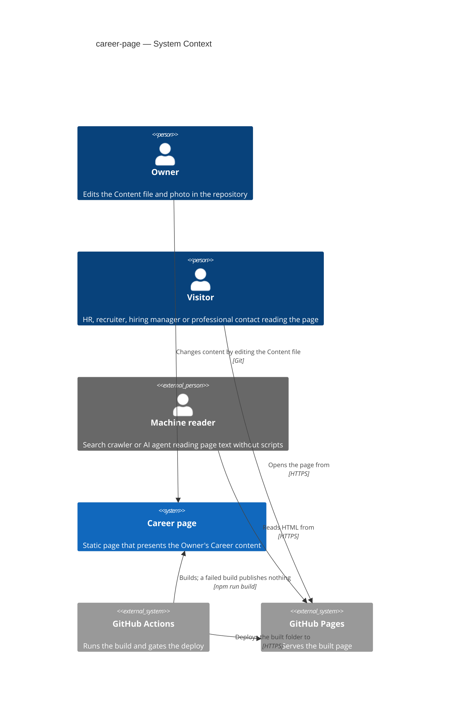
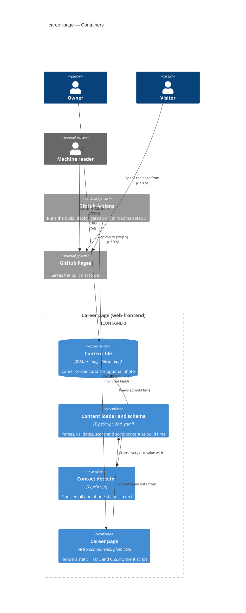
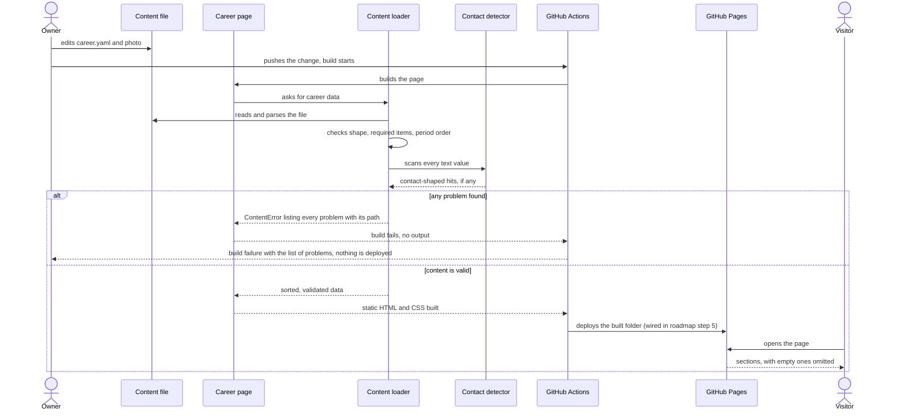

# Software Architecture Document — career-page

## 1. Introduction and goals

**Intent.** The home page presents the Owner's Career content (profile with an optional photo, Positions, achievements, skills, education) as Career sections produced entirely from one Content file. The Content file is checked before anything is published, so invalid content stops the build instead of producing a partial or broken page. All Career content is plain page text a Machine reader can read without running scripts. It serves Visitors (HR, recruiters, hiring managers, professional contacts) and Machine readers; only the Owner changes content.

**Top-3 quality goals (1-liners; full scenarios in §10):**

1. **Content integrity** — invalid Career content, including contact-shaped text, never reaches a published page, and the Owner is told exactly what to fix.
2. **Readable as plain text** — every Content-file text item is present in the delivered page, with no script needed (the photo's alt text is delivered as the image's `alt` attribute).
3. **Contact privacy** — the Owner's raw email and phone never appear in any delivered file.

A fourth, measured goal (speed and accessibility, QG-4 in §10) comes straight from spec §6.

**Stakeholders.**

| Role | Interest | Sign-off owner? |
|---|---|---|
| Owner | supplies and edits the Content file, publishes | No |
| Visitor | reads the Career sections to get to know the Owner | No |
| Machine reader | reads the page text without running scripts | No |
| Tech Lead | SAD approval | Yes |
| Security Lead | the contact-privacy rule (AC-12, AC-13) | Yes |

<!-- Decision overrides (¶4) — populated by the critic resolution loop, empty otherwise. -->

- Decision override: include a photo of the Owner — rationale: the Owner answered the spec §8 photo question with "I want photo" (2026-10-17). This supersedes the spec §3 photo non-goal and the spec §6 "Delivered page weight" wording "no images" (the 100 KB limit still applies to HTML and CSS only). The spec amendment is pending (see §11).

## 2. Constraints

**Technical.**
- TypeScript on Node.js 22 LTS, pinned by `.nvmrc` and `engines` (ADR 0001, foundation).
- Astro ^7.4.0, static output, plain CSS with CSS variables; no UI framework, Tailwind or CSS-in-JS.
- Zod 4 (re-exported by `astro/zod`) for the content schema; `yaml` (YAML 1.2, currently 2.9.1) as the Content-file parser, declared explicitly in `package.json`; `sharp` for the photo, declared explicitly in `package.json` (Astro lists it only as an optional dependency, and the no-EXIF guarantee in QG-3 depends on it).
- No datastore, backend or database (ADR 0002 foundation). Hosting is GitHub Pages (ADR 0004 foundation).
- Pages import components and `src/lib/` modules directly; no DI or registry.

**Organisational.**
- Size S, route quick; no deadline or trigger (idea brief §4).
- Single-person project: the Owner is also the Tech Lead.

**Conventions.**
- `CLAUDE.md` and `docs/architecture-map.md` (reflects the scaffold target; the skeleton now exists).
- Content lives in `src/content/` and is validated at build time; invalid content fails the build.
- Hard rule: anything touching email or phone goes in `src/lib/contact/` with a test in `tests/` that asserts their absence from the built HTML.

**Regulatory / external.**
- Career content is public by the Owner's choice; no Visitor data is collected (spec §6.1). The photo is personal data the Owner chose to publish.
- N/A: no compliance regime applies.

## 3. Context and scope

The Owner edits one Content file in the repository; the photo is a Career content item that the Content file references by file name. At build time the page validates them and renders static HTML and CSS. Visitors and Machine readers read the result from GitHub Pages. The contact section, search metadata and the go-live wiring belong to roadmap steps 3, 4 and 5.

<!-- brownfield: skeleton present — Astro project with a placeholder `content.json`, one `index.astro`, global CSS, a smoke test; no components or lib modules yet. -->

**External systems (in / out):**

| Actor or system | Type | Interaction |
|---|---|---|
| Owner | Person | edits the Content file and the photo in the repository |
| Visitor | Person | opens the page in a browser and reads it |
| Machine reader | Non-human actor (drawn as `Person_Ext` only because C4 has no other actor symbol) | fetches the HTML and reads the text without scripts |
| GitHub Actions | System (external) | runs the build; deploy is gated on its success (wired in roadmap step 5) |
| GitHub Pages | System (external) | serves the built `dist/` folder (ADR 0004) |

Trust boundary: the Content file and photo are Owner-controlled input and are still checked at build time (schema, contact shapes, markup escaped). Everything after the build is public.

**C4 Context (L1):**



## 4. Solution strategy

**Target surface.** `target_surfaces: [web-frontend]`, one surface. The build-time modules (content loader, contact detector) are internal to the one deployable and are not separate surfaces. There is no `backend-service` (ADR 0002 foundation).

**UI architecture.** Server-rendered static HTML (SSG) with zero client JavaScript in this step. This is already decided by foundation ADR 0001 and did not cross the gate again, so it is an inline note, not a new ADR. The contact reveal script is roadmap step 3's budget.

**Top strategic choices (the seeds for ADRs):**

1. **Single YAML Content file validated by a typed schema** — one `src/content/career.yaml` is the only file the Owner edits for what the page says (US-05); the photo is an optional Career content item inside it (`photo` with `file` and `alt`), and the image itself sits in `src/assets/`. A Zod schema checks shape, required items and period order, and reports every problem with its path. YAML gives comments, plain multi-line text and line/column on syntax errors, which AC-08 needs ("where in the Content file"). → feature ADR 0001.
2. **Fail the build, not the page** — validation runs when the page module loads at build time and throws one `ContentError` listing every problem. `astro build` exits non-zero and writes no `dist/index.html`, and the deploy job in step 5 depends on that success. This delivers AC-10 and the invariant "invalid content is never published, not even partially".
3. **Reject contact-shaped text by pattern** — every text value (including the photo `alt`) is scanned for email and phone shapes at build time, and a hit fails the build (AC-12). The same shapes drive the `dist/` absence test (AC-13). → feature ADR 0002.
4. **Plain text in, escaped text out** — components print values only as escaped `{value}`; `set:html` is banned by a new lint rule this feature adds to `eslint.config.js` (`astro/no-set-html-directive`; `tasks` must include it), so markup in content is shown as text, never executed (spec §6.1). Empty Career sections are omitted entirely (AC-06).
5. **Photo processed at build time** — an optional `photo` entry (file under `src/assets/`, required `alt`) is resized and re-encoded by Astro's image pipeline (`sharp`) into a small, explicit-size image. Re-encoding drops source metadata (EXIF), so the delivered file carries no location or contact data (AC-13 "any other delivered file"). Inline decision, no ADR: the choice is reversible in hours and lives in one component.

Assumptions taken (easy depth, accepted by the Owner on 2026-10-17): English (`<html lang="en">`), the five Career sections, plain text only, dates to the month (`YYYY-MM` strings) displayed as "Mar 2021 – Present" from a fixed English month table (no `Intl`); Positions order: ongoing first, then newest start first, ties keep the Owner's order.

## 5. Building block view

The page is a single deployable with a layered, build-time pipeline: the data module (`src/content/`) is the only reader of the Content file, the page imports it, and presentational components receive already-validated, already-sorted data. The contact-shape logic is isolated in `src/lib/contact/` (hard rule). No DI, no registry.

**Internal decomposition:**

```
src/
├── content/
│   ├── career.yaml        the Content file (the only file the Owner edits for text)
│   ├── schema.ts          Zod schema, types, required items, period-order rule
│   └── load.ts            read file, parse YAML, validate, scan, sort; throws ContentError
├── assets/photo.*         the Owner's photo (optional)
├── lib/contact/
│   └── detect.ts          email / phone shape detection + exemptions (no raw values)
├── components/            Section, Profile, Positions, Achievements, Skills, Education
├── pages/index.astro      calls the loader, renders sections
└── styles/global.css      CSS variables, mobile-first layout
tests/                     schema + detector unit tests, build-output tests, failing-build test
```

**C4 Container (L2):** one container for the single `web-frontend` surface, with the build-time modules shown inside the same deployable.



The contact reveal script (roadmap step 3) will add a second, browser-side module under `src/lib/contact/`; it is not drawn here.

## 6. Runtime view

The page has no runtime server logic; the only "runtime" is the build. A Visitor's request is a plain file fetch. This flow is seeded here; the `sequences` stage covers the remaining ACs.

**Critical flow 1: publish career content (happy path and invalid-content branch)**



## 7. Deployment view

<!-- N/A: reuses the deployment decided in ADR 0004 (GitHub Pages from GitHub Actions); this feature adds no infra. Wiring the deploy job and gating it on the build is roadmap step 5. -->

Only the build contract is set here: `npm run build` must exit non-zero and emit no `dist/index.html` when content is invalid, so the step-5 deploy job can depend on it.

## 8. Crosscutting concepts

| Concept | Convention | Where defined |
|---|---|---|
| Logging | none at runtime; build errors printed by `ContentError` | here |
| Authentication | N/A, public read-only page; only Owner edits the repo | spec §6.1 |
| Error handling | content validated at build time; one `ContentError` lists every problem as, for example, `career.yaml: positions[1].employer — required`; YAML syntax errors add line and column | ADR 0001 (foundation), here |
| ID strategy | N/A, no stored records | ADR 0002 (foundation) |
| Internationalisation | N/A, single language (English, `lang="en"`) | spec §3 |
| Escaping | values printed only as escaped `{value}`; `set:html` banned by a new lint rule added by this feature | here |
| Contact data | any email/phone shape in text fails the build; raw values never in `dist/` | `src/lib/contact/`, feature ADR 0002 |
| Styling | plain CSS, variables in `src/styles/` | architecture-map |
| Observability | N/A, no runtime | — |

## 9. Architecture decisions

| # | Title | Status | Section |
|---|---|---|---|
| 0001 | Store career content in one YAML file | Accepted | §4 |
| 0002 | Reject contact-shaped text by pattern | Accepted | §4 |

ADR files live under `docs/features/career-page/adr/NNNN-<title>.md`. Foundation ADRs 0001–0004 live in `docs/adr/` and are referenced as "foundation ADR".

## 10. Quality requirements

**QG-1. Content integrity**
- **When:** the Content file is invalid (missing name, headline, employer, title or start month; a Position ending before it starts) or any text contains something shaped like an email or phone number.
- **Then:** the build fails, produces no output, and 100% of validation failures name the offending entry and what is wrong (spec §6: "Failure message quality"); content check plus build time ≤ 60 s.
- **How verify:** Vitest unit tests of the schema and detector for each AC-08/08b/09/12 case, asserting the message names the path; one test runs the build against an invalid fixture (via `CV_CONTENT_FILE`) into a separate output directory, so it never touches the `dist/` that the global setup builds for the other tests, and asserts non-zero exit and no `index.html` there; build job duration in CI.

**QG-2. Readable as plain text**
- **When:** a Machine reader reads the built page without running scripts.
- **Then:** 100% of Content-file text is present in the delivered page text, comparing values after display formatting (dates only), in the order a Visitor sees it; the photo's alt text is part of the comparison, read from the image's `alt` attribute.
- **How verify:** build-output test that compares the Content file against the built page (spec §6: "Works without scripts"); the test also checks `<script>` text in content is escaped.

**QG-3. Contact privacy**
- **When:** the page is built and delivered in any form (HTML, CSS, images, other files).
- **Then:** no raw email address and no raw phone number appear anywhere in `dist/` (AC-13), and the photo carries no source metadata.
- **How verify:** build-output test scanning every file in `dist/` for the email and phone shapes (spec §8 default; the Owner's real values belong to roadmap step 3), plus a check that delivered images contain no EXIF segment.

**QG-4. Speed and accessibility**
- **When:** a Visitor opens the page on a mobile phone.
- **Then:** Largest Contentful Paint ≤ 2.5 s on a simulated mid-range phone over a 4G connection, empty cache; Lighthouse performance score, mobile ≥ 90; Lighthouse accessibility score ≥ 95 and text contrast ratio ≥ 4.5:1; HTML and CSS ≤ 100 KB uncompressed; no horizontal scrolling at a 320 px viewport width; works in the latest 2 versions of Chrome, Safari, Firefox and Edge.
- **How verify:** Lighthouse mobile run on the built page (gate inherited by roadmap step 5); build-output test summing the built HTML and CSS; manual 320 px and browser smoke checks (gates inherited by step 5). The photo must meet the same LCP and score targets.

## 11. Risks and technical debt

| Risk / debt | Severity | Mitigation | Owner |
|---|---|---|---|
| Photo contradicts the spec (§3 non-goal, §6 "no images" wording) and has no AC yet | Medium | amend the spec (new US/AC for photo, alt text in the AC-11 / QG-2 comparison, metadata, and photo as Career content in the glossary) with `/sdd:clarify career-page` or by hand before `tasks` | Owner, before `tasks` |
| Photo is likely the LCP element and could break LCP ≤ 2.5 s or the score ≥ 90 | Medium | resize to the displayed size, modern format, explicit width and height; pick a byte budget when the photo is authored and verify with Lighthouse | Tech Lead, before `implement` |
| Photo metadata (EXIF, GPS) could leak personal data | Medium | build re-encodes the image with `sharp` (metadata dropped by default); test asserts no EXIF segment in `dist/` | Tech Lead, before `implement` |
| A 9-digit phone written as groups of 3 digits separated by spaces passes the "grouped amount" exemption | Low | accepted; the Owner reviews text; revisit in ADR 0002 if it bites | Tech Lead, accepted |
| Free text such as an ISO date "2021-03-15" or a long ID is rejected as phone-shaped | Low | the error names the entry; the Owner rewords | Owner, accepted |
| The real Content file and photo are not yet supplied (assumed set, English) | Medium | Owner exports career.yaml (agreed 2026-10-17); fails fast through the schema | Owner, before `implement` |
| Astro cleans `dist/` at build start, so a failed build leaves no previous output locally | Low | intended; the deploy job in step 5 must not publish on failure; the failing-build test uses its own output directory (QG-1) | Tech Lead, before step 5 |
| Project-style Pages URL needs a `base` path (foundation ADR 0004) | Low | Astro prefixes asset URLs from `base` automatically; set `site`/`base` at go-live | Tech Lead, before step 5 |
| The brief's outcome "a visitor books a call or contacts the owner" is not measurable without a backend | Low | default: not measured (spec §8) | Owner, before step 5 |

**Accepted debt (acceptable in v1, plan to fix later):**
- Contact detection is heuristic (shape-based), not a phone-number parser.
- `CV_CONTENT_FILE` exists only so a test can point the build at an invalid fixture.

## 12. Glossary

| Term | Meaning |
|---|---|
| Career content | facts about the Owner's professional life that the page presents: profile, positions, achievements, skills, education (and the photo). Not contact details |
| Career section | one titled block of the page presenting one kind of Career content |
| Content file | the single Owner-maintained file (`career.yaml`) that holds all Career content; the photo is referenced from it by file name |
| Machine reader | a search crawler or AI agent that reads page text and cannot be assumed to run scripts |
| Owner | the person whose career the page presents and who maintains the content |
| Position | one employment entry: employer, title, period, achievements |
| Visitor | a person (HR, recruiter, hiring manager, professional contact) reading the page |
| ContentError | the single build-time error that lists every content problem with its path |
| Contact shape | text that looks like an email address or a phone number, whether or not it is the Owner's own |
| Ongoing Position | a Position with a start month and no end; displayed as "Mar 2021 – Present" and listed first |
