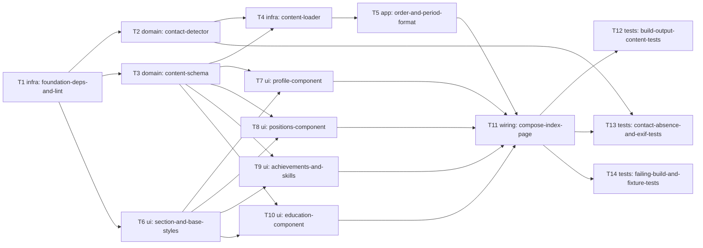

# Epic — career-page

> **Spec:** [spec.md](../spec.md) · **Design:** [sad.md](../sad.md) · **Screens:** [screens.md](../screens.md) · **ADRs:** [adr/](../adr/) · **Foundation ADRs:** [docs/adr/](../../../adr/)

## Goal

Ship the Career part of the home page: a single static page whose Profile, Positions, Achievements, Skills and Education sections are produced entirely from `src/content/career.yaml`, which is validated (including contact-shaped text) before anything is built. Invalid content fails the build and publishes nothing; all content is plain text a Machine reader can read without scripts (spec §2).

## Scope

- **In:** dependencies and lint rule; `src/lib/contact/detect.ts`; `src/content/{schema,load}.ts`; six components and base CSS; `index.astro` composition; unit, build-output, contact-absence and failing-build tests.
- **Out:** the contact section and reveal script (roadmap step 3), search and agent metadata (step 4), deploy gating and go-live (step 5), formatted text or links in content, several languages, theme switching (spec §3). No `data-model.md`, no API, no migrations (ADR 0002).

## Task map

Parallel branches: after T1, the detector (T2), schema (T3) and Section/base CSS (T6) start together; the four component tasks (T7–T10) run in parallel once T3 and T6 are done; the three test tasks (T12–T14) run in parallel after T11. T4 and T5 share `src/content/load.ts` and are serialized.

## Tasks

See [tracker.md](./tracker.md) for status. Machine contract: [tasks.json](../tasks.json).

| # | Task | Layer | Blocked by | DoD (short) |
|---|---|---|---|---|
| T1 | [Declare yaml and sharp dependencies and ban set:html in lint](./t1-foundation-deps-and-lint.md) | infra | — | yaml + sharp declared; lint fails on set:html |
| T2 | [Implement the contact-shape detector with table-driven unit tests](./t2-contact-detector.md) | domain | T1 | detector unit tests pass (shapes + exemptions) |
| T3 | [Define the Zod content schema with required items and period-order rule](./t3-content-schema.md) | domain | T1 | schema tests pass for AC-08/08b/09 with named paths |
| T4 | [Build the content loader: parse YAML, validate, scan, throw ContentError](./t4-content-loader.md) | infra | T2, T3 | loader tests pass; any issue throws one ContentError |
| T5 | [Sort Positions and format periods in the loader](./t5-order-and-period-format.md) | app | T4 | ordering + period-format tests pass (AC-02/03) |
| T6 | [Add the Section component and base page styles](./t6-section-and-base-styles.md) | ui | T1 | Section renders nothing when empty; base CSS in place |
| T7 | [Build the Profile component with the optional processed photo](./t7-profile-component.md) | ui | T3, T6 | Profile renders photo+text; no-photo variant clean |
| T8 | [Build the Positions component with optional parts](./t8-positions-component.md) | ui | T3, T6 | Positions render with optional parts omitted cleanly |
| T9 | [Build the Achievements and Skills list components](./t9-achievements-and-skills.md) | ui | T3, T6 | Achievements/Skills lists in Owner order; empty omitted |
| T10 | [Build the Education component with optional period](./t10-education-component.md) | ui | T3, T6 | Education renders with/without period; empty omitted |
| T11 | [Compose index.astro from the loader and components; remove the placeholder](./t11-compose-index-page.md) | wiring | T5, T7, T8, T9, T10 | page composes from loader; invalid content emits no index.html |
| T12 | [Add build-output tests: text, order, escaping, weight, read-only](./t12-build-output-content-tests.md) | tests | T11 | dist text/order/escape/weight/read-only tests pass |
| T13 | [Add dist-wide contact absence and image metadata tests](./t13-contact-absence-and-exif-tests.md) | tests | T11, T2 | dist scan: no email/phone shapes, no EXIF |
| T14 | [Add failing-build and content-only-change fixture tests](./t14-failing-build-and-fixture-tests.md) | tests | T11 | invalid fixtures fail the build with named entries; AC-06/07 hold |

## Risks / Hard rules

- **Contact details:** raw email and phone never in `dist/`; contact logic only in `src/lib/contact/` with an absence test (CLAUDE.md, ADR 0003, T2/T13).
- **Escaping:** values printed only as `{value}`; `set:html` banned by lint (T1).
- **Real content gap:** the Berlingske Media Position in `career.yaml` has no achievements, which AC-08b rejects. The Owner must add one before T11's build is green on real content (spec §8, Owner task, before implement).
- **Photo and LCP:** the photo is the likely LCP element; verify with Lighthouse at go-live (SAD §11; gate inherited by roadmap step 5).
- **Heuristic detector:** ISO dates are rejected as phone-shaped; 9-digit grouped-by-3 text passes (accepted, SAD §11).
