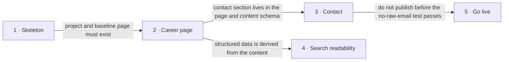

# Roadmap — cv-page

> **A decomposition, not a promise.** The overall idea broken into incremental steps: what each
> step is, where it comes from, how big it is — or that nobody has looked at it yet — and in which
> order, and parallel lanes, we walk them. **No dates** (except shipped history), **no scores** —
> order is the prioritization. The *solution* for any step lives in its `docs/features/<slug>/`
> spec, not here.

## Destination

A recruiter or hiring manager opens one public page, reads the owner's Engineering Manager career story, and can book a call or reach the owner, while search engines and AI agents can read the page and the raw email and phone never appear in the published HTML.

## Steps

| # | Step | Source | Size | Status |
|---|---|---|:---:|---|
| 1 | Project skeleton: Astro/TypeScript project with tests, lint and the Pages workflow | architecture-map.md Module inventory | S | idea |
| 2 | Career page: owner content renders as sections, validated by a typed schema | idea-brief.md §7 Recommendation | M | idea |
| 3 | Contact section: public booking and LinkedIn links, email and phone revealed on click | idea-brief.md §5 Out of scope | M | idea |
| 4 | Search and AI-agent readability: structured data, sitemap, robots, metadata | idea-brief.md §3 Users | S | idea |
| 5 | Go live: repository, remote, Pages setup, URL, link from CV and LinkedIn | ADR 0004 | S | idea |

## Not yet specified

| Area | What we'd have to learn | Blocks | How it gets sharpened |
|---|---|:---:|---|
| _(none — no fog surfaced)_ | | | |

## Out of scope

- Backend, database or server-side logic — decided in ADR 0002; the page is static.
- Hosting other than GitHub Pages — decided in ADR 0004.

## Open decisions

| # | Question | Type | Owner | Blocks |
|---|---|:---:|:---:|:---:|
| D1 | Which booking tool fulfils "book a call": an existing one or a new one? | grilling | human | 3 |
| D2 | What are the content file's format, language and amount? | task | human | 2 |
| D3 | Is a contact form wanted in addition to the booking link and LinkedIn? | grilling | human | 3 |

## Decisions so far

- Build as a static Astro site in TypeScript → [`ADR 0001`](adr/0001-build-the-page-as-a-static-astro-site.md)
- Ship no backend and no database → [`ADR 0002`](adr/0002-no-backend-or-database.md)
- Protect email and phone by assembling them in the browser → [`ADR 0003`](adr/0003-protect-contact-details-by-client-side-assembly.md)
- Host on GitHub Pages → [`ADR 0004`](adr/0004-host-on-github-pages.md)
- Booking link and LinkedIn URL are public; email and phone are obfuscated → [`idea-brief.md §5`](idea-brief.md)

## Dependency graph

## Execution path

| Wave | Steps | Zone per step (why parallel-safe) | Unlocks |
|:---:|---|---|---|
| 1 | 1 | `src/`, `public/`, `tests/` (all new) | 2 |
| 2 | 2 | `src/content/`, `src/components/`, `src/pages/` (all new) | 3, 4 |
| 3 | 3 ∥ 4 | 3: `src/lib/contact/`, Contact component · 4: page head, `public/`, structured-data component (all new, disjoint) | 5 |
| 4 | 5 | `.github/workflows/` (new), repository settings | — |

## Shipped

| Step | Shipped | Link |
|---|---|---|
